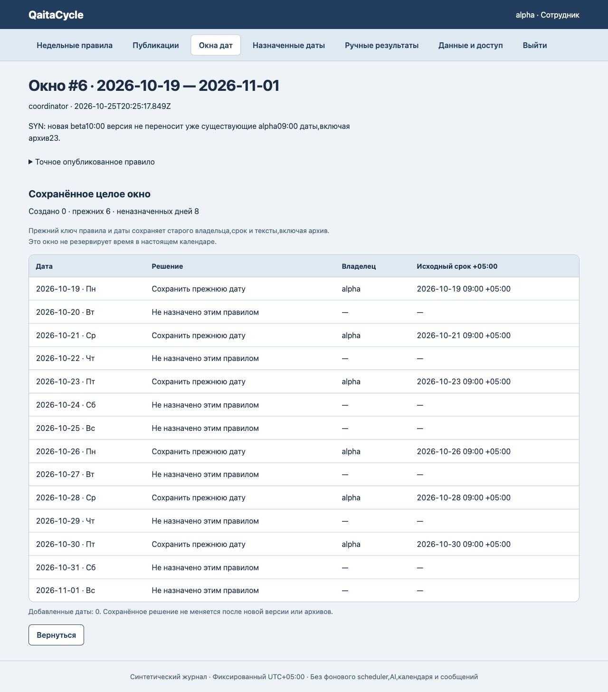

# QaitaCycle

Original bounded v0.1, reference16 Lindy inspiration only. Own DalelCheck Shared Work Cabinet extension, preserving navy/pale/green/native forms; no visual-world replacement or prior data edits. Admin publishes both authored RU/KK instruction texts, one existing account owner, ascending distinct weekday digits1..7(Mon..Sun) and HH:MM time. Draft may be incomplete. Publication immutable exact version; repeat version forbidden even after archive. Meaningful routine edits increment version; no full intermediate draft history.

Admin explicitly previews then saves one inclusive date window1..31days, dates2020..2100, requiring at least one newly scheduled or existing date (existing keys take priority even if weekdays changed). Fixed synthetic UTC+05:00 offset, no IANA/DST/historical timezone inference. Each calendar date reports off_day/create/keep_existing. Permanent routineID+date key across every publication and archive: existing occurrence always kept with original owner/time/text, never migrated or resurrected. A zero-new window is a real immutable record. BEGIN IMMEDIATE checks global revision then recomputes whole plan and creates all occurrences or nothing. Preview never reserves/writes; HTTP preview/hash not required or proof of reading.

Only the immutable occurrence owner can once record completed or skipped, with rationale, at/after dueAt and creation time. Admin cannot bypass owner. Both are manual assertions,not evidence of service or real performance. Elapsed time/GET/refresh never marks done. No early done/skip, reopen/reversal/reassign/partial materialization/background scheduler/notifications. Outcomes and windows form one contiguous server seq/time ledger; clock rollback before latest quantity-free ledger event refuses. Global UUID on windows/outcomes never freed; replay refuses,not idempotent success. Client cannot set selected dates/owner/dueAt/snapshot/result actor/time/IDs.

Archive routine/publication closes new windows; existing pending occurrences may resolve by owner after due. Pending occurrence cannot archive; resolved can,visibility only,datekey never freed. Windows/outcomes cannot edit/archive. All staff read one shared area,no tenant isolation. Admin routines/pub/windows/archive/accounts/backup;staff own outcomes. Current account existence enforced by HTTP routine save and empty restore; trusted direct WorkStore validates name format/domain only. Unsigned JSON/hash consistency not authenticity/historical account identity/rights;accounts/auth/audit excluded,empty restore only,HTTP2MB/fullconsistentSQLitebackup separate. No UI password reset/session revocation. Synthetic only;no Lindycode/brand/AI/LLM/real calendar/email/meeting/calls/external integrations/secrets/messages/payments/customer outcomes.

Different from StepBook one-off instruction steps: published recurring weekdays and date-window dedup. Different from KezekShift dispatch: fixed account/date, no capacity/priority queue or claim. No financial records or physical stock. Operate inherited extension: date decisions before explicit all-or-none save, preserved old snapshot before owner-only completion; stale forms retain input. User explicitly continues original100 queue without pausing.

Node>=24.15<25, `npm test`; WORK_ADMIN_PASSWORD then `npm start`. Defaults127.0.0.1:8856; PUBLIC_ORIGIN/DATABASE_PATH/HOST/PORT optional. Never commit .data/credentials/SQLite.

## Проверки и происхождение

24 предметных/HTTP/хранилищных теста проходят. Браузер подтвердил перекрывающиеся окна, неизменные прежние назначения, нулевое окно и запреты stale/ранней отметки. Собственный файловый перезапуск сохранил все5таблиц;33 прежние базы неизменны. [Полные границы доказательств](docs/verification.json).

UI использует собственный кабинет DalelCheck (8bb1213ca5fb564b5f766edbbb8892fb04440bff). Первое ревью9экранов нашло потерю ввода после обновления; F1 исправлен и повторно оценён resolved по2текущим1280снимкам, без нового полного UI/securityаудита. Сохраняются выбор/основание; уже записанный другой сессией результат показан отдельно от несохранённого read-only текста. [Ревью](docs/finish-review.json) · [Дизайн](DESIGN.md).

Только синтетический локальный процесс; публичный репозиторий размещает код, не сервер.
